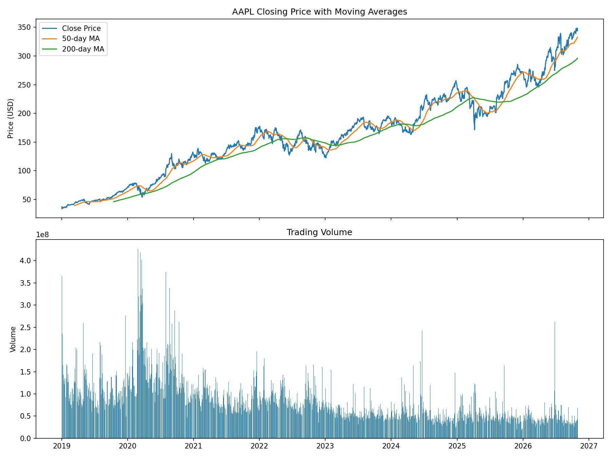
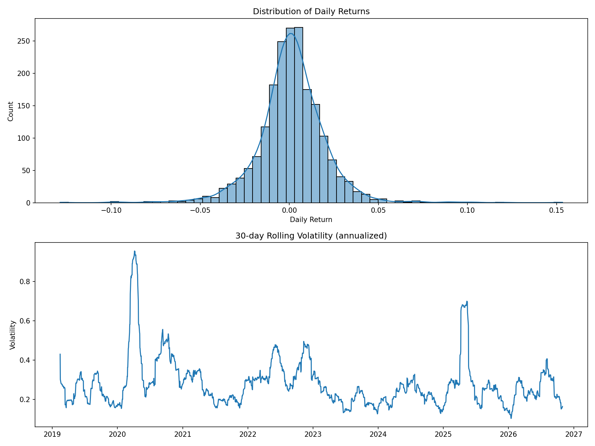
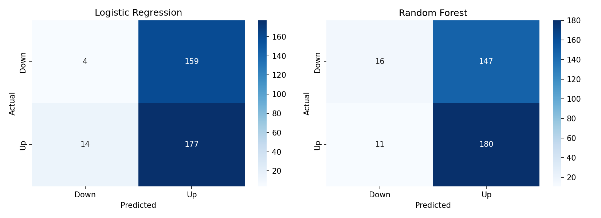

# Finance Project: AAPL Stock Analysis and Next-Day Direction Prediction

## 1. Objective
Analyze Apple (AAPL) stock price data, study its trend, returns and volatility, and build machine learning models to predict whether the next day's closing price will go up or down.

## 2. Dataset
- Source: Yahoo Finance, downloaded with the yfinance Python library
- Stock: AAPL (Apple Inc.)
- Period: 2019-01-02 to 2026-10-30
- Size: 1969 trading days
- Columns: Open, High, Low, Close, Volume

## 3. Data Preparation
- Checked for missing values and duplicate dates, and dropped any incomplete rows.
- Created 50-day and 200-day moving averages.
- Created daily returns and 30-day rolling volatility (annualized).
- Created features for prediction: returns of the previous 3 days, ratio of the 50-day to the 200-day moving average, price relative to the 50-day moving average, and change in volume.
- Target: 1 if the next day's close is higher than today's close, otherwise 0.

## 4. Exploratory Analysis

### Price trend and volume

- Highest close: 348.65 on 2026-10-29
- Lowest close: 33.68 on 2019-01-03

### Daily returns and volatility

| Metric | Value |
|---|---|
| Average daily return | 0.131% |
| Daily standard deviation | 1.924% |
| Best day | +15.33% (2025-04-09) |
| Worst day | -12.86% (2020-03-16) |
| Positive days | 53.8% |

## 5. Prediction Model
The data was split by time: the first 80% of days for training and the last 20% (354 days) for testing. Two models were trained:
- Logistic Regression
- Random Forest

A baseline was also calculated, which always predicts "Up" (the most common class in the test set).

| Model | Accuracy |
|---|---|
| Baseline (always "Up") | 53.95% |
| Logistic Regression | 51.13% |
| Random Forest | 55.37% |

### Confusion matrices

Top features for Random Forest: Return (0.176), Return_lag1 (0.145), MA_ratio (0.145), Return_lag3 (0.143).

## 6. Conclusion
- AAPL showed a strong long-term upward trend, with a sharp drop during the COVID-19 market crash in March 2020.
- Volatility was highest during market stress periods, and extreme days (+15.33%, -12.86%) were rare.
- Predicting next-day direction is very difficult. Random Forest reached 55.37% accuracy, only about 1.4 percentage points above the baseline of 53.95%. Logistic Regression (51.13%) was below the baseline.
- Both models mostly predicted "Up". Random Forest correctly identified only 16 of 163 actual "Down" days.
- Daily returns and moving averages alone are not enough to predict next-day direction reliably.
- Future work: add more features (market index, news sentiment, longer-term indicators), try other models, and test over different periods.

## 7. Files
- finance_stock_analysis.ipynb: full analysis notebook
- finance_price_trend.png: closing price, moving averages and volume
- finance_returns_volatility.png: return distribution and volatility
- finance_confusion_matrices.png: model confusion matrices

## 8. Tools Used
Python, Pandas, NumPy, Matplotlib, Seaborn, scikit-learn, yfinance, Google Colab

## 9. Disclaimer
This project is for learning purposes only and is not financial advice.
